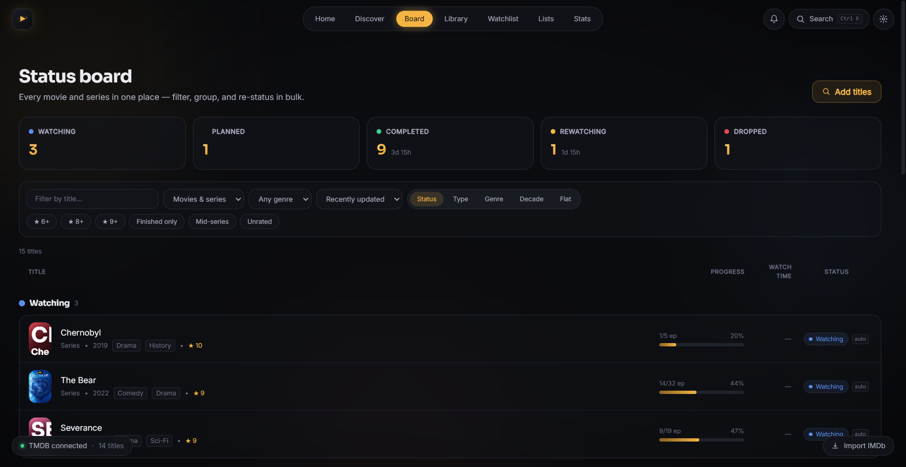
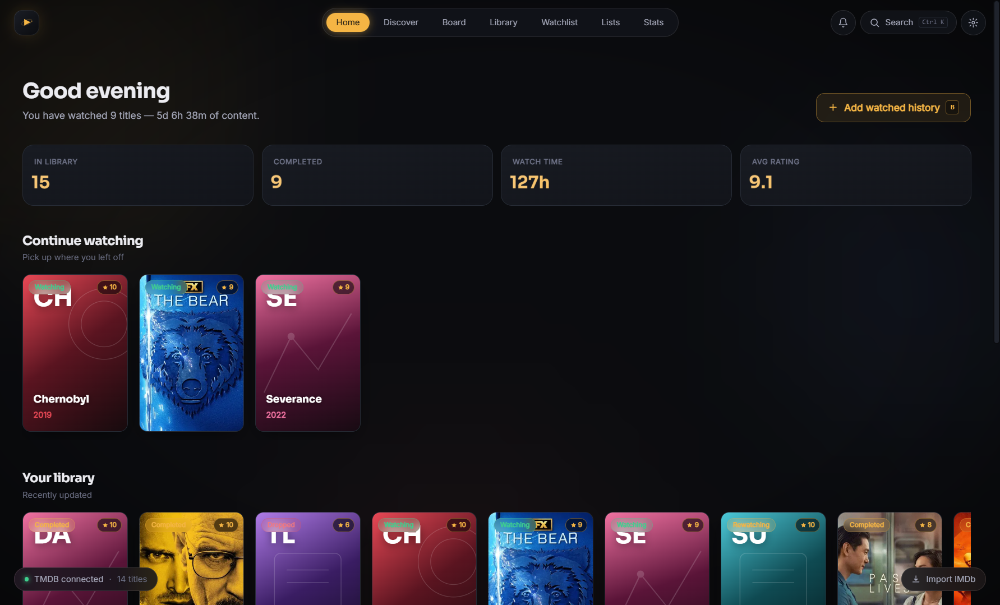
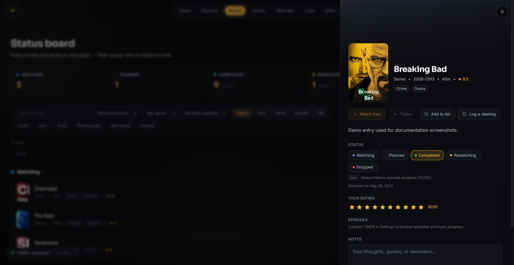
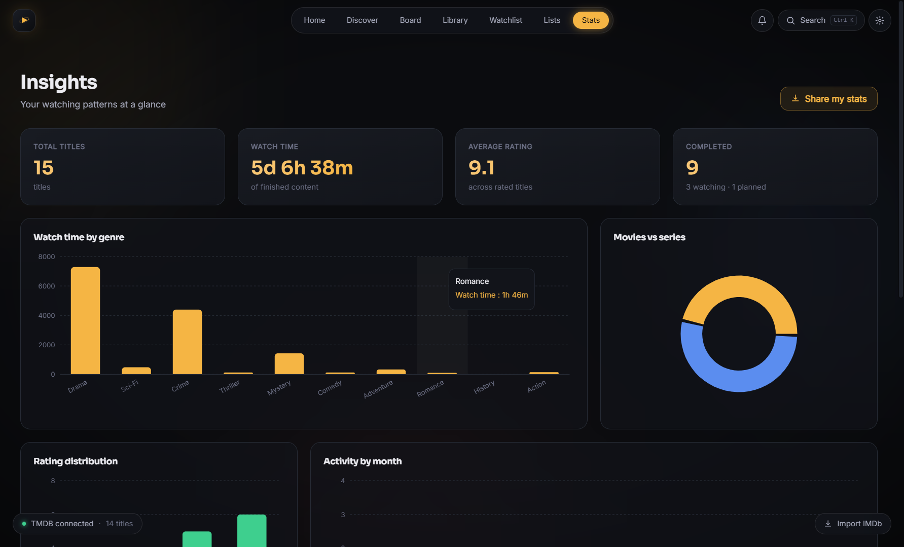
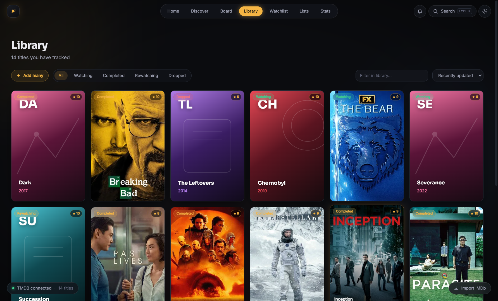
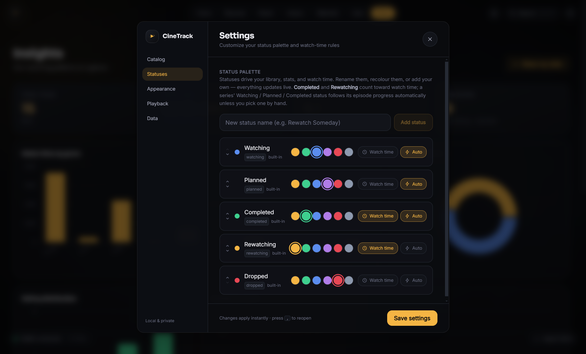
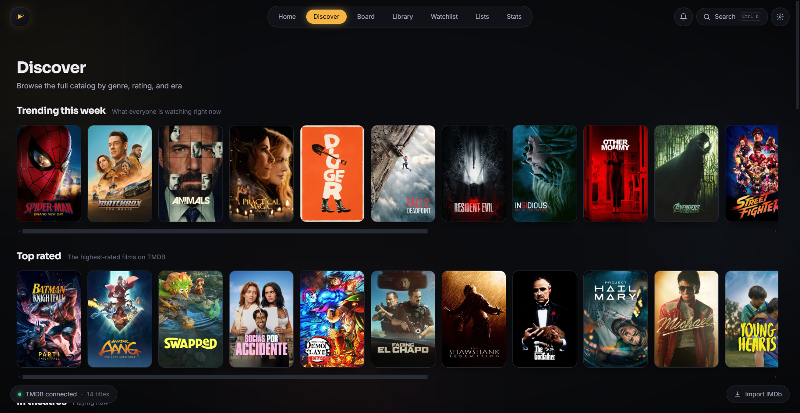
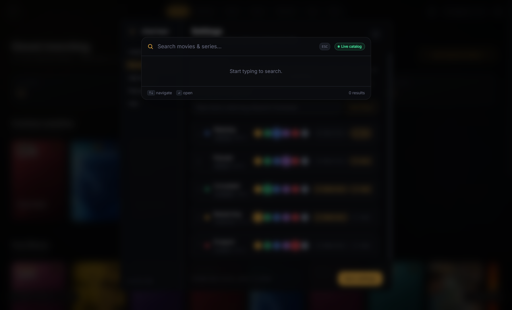

<div align="center">


# CineTrack

**A beautiful, private desktop app for tracking every movie and series you watch.**

[](https://electronjs.org)
[](https://react.dev)
[](https://www.typescriptlang.org)
[](LICENSE)

[](https://github.com/YumIya0606/CineTrack/actions/workflows/ci.yml)
[](LICENSE)

</div>

---

## Screenshots

<div align="center">

### Status board — every title, filterable and grouped



### Home — your library at a glance



### Detail — cast, episodes, ratings and notes



</div>

<details>
<summary><b>More screenshots</b></summary>

| | |
|---|---|
|  |  |
|  |  |
|  |  |

</details>

---

## ✨ Highlights

### A status system that actually makes sense

Most trackers give a series one flat status, so `Completed` ends up sitting next to *3 of 62 episodes watched*. CineTrack separates **what you want** from **how far you are**:

| Progress | Auto status |
| --- | --- |
| 0 episodes | **Planned** |
| 1 … N-1 episodes | **Watching** |
| All N episodes | **Completed** + the finish date is stamped for you |

- Movies have no episodes, so their status is always manual.
- Pick any status by hand and it's **pinned** — the app never fights you. An `auto` badge tells you when a status is being driven by progress.
- If TMDB doesn't know a series' episode length, type it in once (*"45 min/episode"*) and it starts counting.

### 🛠 Make it yours

**Settings → Statuses** — rename, recolour, reorder, or invent your own statuses.

- Mark any status as **Watch time** (counts toward your totals) or **Auto** (episode progress may assign it).
- Deleting a custom status moves its titles to Planned rather than destroying them.
- Five built-ins ship by default and can always be restyled.

### 📋 The Status board

One screen for your whole collection, **highly filterable**:

- Filter by status, type, genre, rating floor, finished-only, mid-series, unrated, or title.
- Group by **status / type / genre / decade**, or view flat.
- Sort by updated, title, year, rating, runtime, watched date, status, or progress.
- Every row shows a live progress bar and exactly how much watch time it contributes.
- Re-status any title inline without opening it.

### ⚡ Add your whole history in one go

You watched things before this app existed. Press **`B`** and shelf decades of titles at once:

- **Search** — check off as many titles as you like and add them together.
- **Paste a list** — drop in a newline-separated list (years optional); CineTrack matches each title against TMDB and shows you the guesses to confirm.
- Watched dates can be **spread across the past year** so your activity chart looks like real history instead of one spike.

### 📊 Real watch time

Runtimes and episode counts are pulled from TMDB when you shelve a title, so movies *and* series count. **Settings → Data → Recalculate watch time** repairs anything added before that was tracked.

### ☁️ Private by design, backupable on your terms

- Your library is **one SQLite file** on your machine. No account, no telemetry, nothing uploaded.
- Backups are **AES-256-GCM encrypted `.cbk` files** locked by your passphrase.
- Point CineTrack at your **Google Drive / OneDrive / iCloud** sync folder and it writes encrypted snapshots there automatically — the sync client uploads them, so CineTrack never asks for a cloud login.

### 🎬 And the rest

- **Live catalog** — search ~1M titles via TMDB with cast, crew, taglines and "more like this".
- **Curated discovery** — trending, top rated, in theatres, coming soon and airing this week, as one-click rows above the filterable grid.
- **People & franchises** — click any cast or crew name for their filmography; follow a collection through the franchise in release order.
- **Subtitles** — fetched on demand, cached locally, English by default. Press **Sync** when a line you recognise appears and timing locks on.
- **Free streaming** — community embed providers in an ad-blocked, sandboxed webview.
- **Import your history** — drop in an IMDb ratings CSV and titles you never shelved are resolved and added for you.
- **Stats** — genres, decades, rating distribution, activity, most-watched people, and a shareable card.
- **Cinematic UI** — dark gold-on-charcoal, glassmorphism, 3D pointer-tracking poster tilt.
- **Keyboard-first** — `Ctrl+K` search · `B` bulk add · `1–7` switch views · `,` settings · `Esc` close.

---

## 🚀 Getting started

```bash
git clone https://github.com/YumIya0606/CineTrack.git
cd CineTrack
npm install
npm run dev
```

**Requirements:** **Node.js 22 or newer** and npm. Windows is the packaged target; macOS/Linux work with minor packaging changes.

> [!IMPORTANT]
> Node 22 is a hard requirement, not a suggestion. `better-sqlite3` (the database driver) declares `engines.node >= 22` and only publishes prebuilt binaries for that ABI. On Node 20 or older, `npm install` finds no matching prebuild, quietly falls back to compiling from source, and fails unless you have Visual Studio's C++ workload installed.

<details>
<summary><b>🛟 Troubleshooting</b></summary>

**`npm error command ... node-gyp rebuild` / `could not find a version of Visual Studio 2017 or newer`**

`better-sqlite3@13` ships a `binding.gyp`, so npm tries to compile it — even though that release already bundles working prebuilt binaries and needs no compilation at all. The build then fails whenever the installed Visual Studio is newer than what node-gyp recognises (a current machine reports VS 18; node-gyp 9 only looks for VS2017–2022).

Skip the unnecessary native builds and fetch Electron's binary directly:

```bash
npm ci --ignore-scripts
node node_modules/electron/install.js
```

This is exactly what CI does, and it is faster because it skips `sharp`, `esbuild`, and `lzma-native` too. If you hit it on an existing checkout, delete `node_modules` first.

**Posters not appearing**

Posters stream from the TMDB CDN and require a TMDB key in **Settings → Catalog**. Without one, CineTrack falls back to generated artwork. If a title shows a placeholder even with a key, run **Settings → Data → Recalculate watch time**, which re-fetches the missing metadata.

</details>

### Build the Windows installer

```bash
npm run package
```

Produces `release/CineTrack-Setup-1.0.0.exe` — a standard NSIS installer with Start Menu and desktop shortcuts. No Node.js or terminal needed on the target machine.

### Connect TMDB (optional but recommended)

CineTrack works offline, but a free TMDB key unlocks the full live catalog, posters, trailers, and episode tracking.

1. Create a free account at [themoviedb.org](https://www.themoviedb.org/)
2. Request an API key in **your account settings → API**
3. Paste your **read access token** into **Settings → Catalog**

> 🔒 **Your key never leaves your machine.** It's stored in your local app data folder and sent only to TMDB. It is never committed to this repository — see [`.gitignore`](.gitignore).

---

## ⌨️ Keyboard shortcuts

| Key | Action |
| --- | --- |
| `Ctrl` + `K` | Search palette |
| `B` | Bulk add watched history |
| `1` – `7` | Switch view |
| `S` | Jump to stats |
| `,` | Settings |
| `Esc` | Close panel |

---

## 🛠 Tech stack

<div align="center">

| Layer | Technology |
| --- | --- |
| Shell | **Electron** + electron-vite |
| UI | **React 19**, **TypeScript**, **Tailwind CSS v4**, **Framer Motion** |
| State | **Zustand** |
| Data | **better-sqlite3** + **Drizzle ORM** (full-text search) |
| Charts | **Recharts** |
| Blocking | Ghostery adblocker (network layer) |
| Packaging | **electron-builder** |

</div>

---

## 📁 Project structure

```
CineTrack/
├── src/
│   ├── main/              # Electron main process
│   │   ├── db/            # Schema, queries, status palette, board, migrations
│   │   ├── ipc/           # IPC handlers + IMDb CSV import
│   │   ├── tmdb/          # TMDB API client
│   │   └── backup.ts      # Encrypted export/restore + auto cloud backup
│   ├── preload/           # contextBridge API surface
│   ├── renderer/          # React UI
│   │   └── src/
│   │       ├── components/  # TopBar, DetailPanel, StatusPill, BulkAddModal…
│   │       ├── views/       # Home, StatusBoard, Library, Watchlist, Stats
│   │       ├── store/       # Zustand state
│   │       └── lib/         # API bridge, theme, tilt, watch-progress
│   └── shared/            # Types, IPC contract, shared utils + status logic
├── drizzle/               # SQLite migrations
├── scripts/               # Icon + screenshot tooling
└── resources/             # App icons
```

---

## 🧪 Development

| Script | Purpose |
| --- | --- |
| `npm run dev` | Launch with hot reload |
| `npm run build` | Type-check + bundle for production |
| `npm run package` | Build the Windows `.exe` installer |
| `npm test` | Run the Vitest suite |
| `npm run typecheck` | TypeScript checks (node + web) |
| `npm run lint` | ESLint |
| `npm run format` | Prettier |
| `npm run db:generate` | Generate a migration from the schema |
| `npm run icon` | Rebuild app icons from `icon.svg` |

---

## 🔒 Privacy

Your library lives in a single SQLite file inside the app's user-data directory
(`%APPDATA%/CineTrack/data/` on Windows). **No analytics, no telemetry, no account.**

The app talks to exactly three places:

- **`api.themoviedb.org`** — only if you supply your own TMDB key.
- **Your own provider streams** — inside a sandboxed, ad-blocked webview.
- **A subtitle provider** — and only once you actually open subtitles. The built-in provider needs no account; an OpenSubtitles key you add yourself goes to OpenSubtitles and nowhere else. Fetched tracks are cached in your local app data, so the same subtitle is never downloaded twice.

Backups are encrypted with your passphrase. The auto-backup passphrase is held by
the OS credential store (DPAPI on Windows), so it stays bound to your Windows
account and the `.cbk` file is useless anywhere without it.

---

## 📄 License

MIT © [YumIya0606](https://github.com/YumIya0606)

Movie & TV data and poster artwork provided by [TMDB](https://www.themoviedb.org/).
This product uses the TMDB API but is not endorsed or certified by TMDB.
Use of TMDB data is subject to their [terms of service](https://www.themoviedb.org/terms-of-service).

<div align="center">

**Made with ♥ for people with too many tabs open about what to watch next.**

</div>